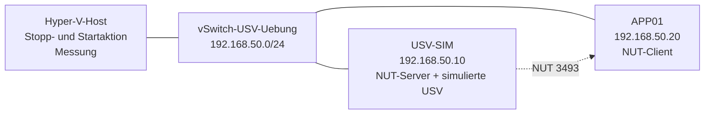

# 01.1 Geordnetes Herunterfahren ohne USV

| | |
|---|---|
| **Modul** | 01 Geordnetes Herunterfahren |
| **Stufe** | Aufbau bis Vertiefung |
| **Geschätzte Zeit** | 3 bis 4 Stunden (Schätzung) |
| **Werkzeuge** | Hyper-V, Debian oder Ubuntu (NUT), PowerShell, Bash |
| **Vorwissen** | Hyper-V-Grundlagen, Linux-Grundlagen (Pakete, Dienste, Textdateien) |

> [!WARNING]
> **Stand der Prüfung: Entwurf.** Die NUT-Skripte wurden in einer Testumgebung mit NUT 2.8.1 unter Ubuntu 24.04 mit echten NUT-Programmen geprüft (simulierte USV, Verzögerung, Server und Client), allerdings mit von Hand gestarteten Programmen statt als Systemdienste. **Auf Hyper-V und mit Systemdiensten wurde nichts davon ausgeführt.** Die PowerShell-Skripte wurden mit nachgebauten Hyper-V-Befehlen getestet, das Zeitbudget mit Rechenproben. Die Werte der Parameter von `Set-VM` stammen aus der Microsoft-Dokumentation. Was nicht gegen eine Quelle geprüft ist, steht als *nicht bestätigt* im Text. Bitte nachbauen und Abweichungen melden.

## Lernziele

Nach dieser Übung kannst du

- erklären, warum eine USV nicht Betrieb, sondern **Zeit für ein geordnetes Herunterfahren** liefert,
- auf einem Hyper-V-Host Stopp- und Startaktion der VMs prüfen, setzen und die Herunterfahrdauer messen,
- eine USV mit NUT **simulieren** und die Kette „Stromausfall → Wartezeit → Herunterfahren“ mit einem Server und einem Client nachvollziehen,
- eine Verzögerung für kurze Ausfälle („Flackern“) einrichten und belegen, dass sie wirkt,
- mit gemessenen Zeiten **rechnen**, ob die Batterielaufzeit reicht,
- die Teile benennen, die ohne echte USV nicht prüfbar sind.

## Voraussetzungen

- Ein Windows-PC oder -Server mit Hyper-V und etwa 8 GB freiem Arbeitsspeicher.
- Zwei Linux-VMs (Debian oder Ubuntu) mit je 1 GB Arbeitsspeicher: `USV-SIM` (NUT-Server) und `APP01` (NUT-Client).
- Mindestens eine weitere Test-VM (beliebiges Betriebssystem) für die Messung der Herunterfahrdauer. Sie wird dabei heruntergefahren und wieder gestartet, also keine VM mit wichtigen Daten.
- Alles läuft in einem **privaten Switch** (`vSwitch-USV-Uebung`, 192.168.50.0/24). NUT sendet unverschlüsselt, das gehört nicht in ein Produktivnetz.

## Grundbegriffe

| Begriff | Bedeutung |
|---|---|
| **USV** | Unterbrechungsfreie Stromversorgung. Überbrückt Ausfälle mit einer Batterie. |
| **Geordnetes Herunterfahren** | Das Betriebssystem beendet Dienste, leert Zwischenspeicher und schließt Dateien, bevor der Strom weg ist. |
| **NUT** | Network UPS Tools. Offene Software, die USV-Daten bereitstellt und Rechner herunterfährt. Läuft als Server (liest die USV) und Clients (fragen den Server). |
| **OL / OB / LB** | Zustände einer USV in NUT: *online* (Netzbetrieb), *on battery* (Batteriebetrieb), *low battery* (Batterie schwach). |
| **FSD** | *Forced Shutdown*. Der Server signalisiert allen Clients, dass jetzt heruntergefahren wird. |
| **primary / secondary** | Rollen von `upsmon`. Der Primary steuert den Ablauf, Secondaries warten auf ihn und fahren zuerst herunter. |
| **Stoppaktion** | Einstellung einer Hyper-V-VM: was passiert mit ihr, wenn der Host herunterfährt. |

## Topologie

<!-- tikz:topologie -->


| VM | Rolle | Adresse |
|---|---|---|
| USV-SIM | NUT-Server, simulierte USV `buero-usv`, `upsmon` als primary | 192.168.50.10/24 |
| APP01 | NUT-Client, `upsmon` als secondary | 192.168.50.20/24 |
| Test-VM(s) | nur für die Messung der Herunterfahrdauer | beliebig |

Der Host selbst wird nicht von NUT gesteuert (siehe „Grenzen der Übung“). Namen und Adressen sind erfunden.

## Aufgabe

### Teil 1: Den Hyper-V-Host vorbereiten

**1. Bestandsaufnahme**

- **GUI:** Hyper-V-Manager → VM → *Einstellungen* → *Automatische Stoppaktion* und *Automatische Startaktion*. Unter *Verwaltung* → *Integrationsdienste* muss *Herunterfahren des Betriebssystems* angehakt sein.
- **CLI:** (administrative PowerShell auf dem Host)

```powershell
.\01.1-hyperv-stoppaktion.ps1
```

Das Skript ändert nichts. Es zeigt je VM Zustand, Stoppaktion, Startaktion, Startverzögerung und den Integrationsdienst *Herunterfahren* und liefert den Rückgabewert 1, wenn etwas abweicht. Notiere die Ausgangslage.

Der Integrationsdienst wird über seine Kennung gefunden, weil sein Anzeigename je nach Windows-Sprache anders heißt (*nicht bestätigt*, ob die verwendete Kennung stimmt, das Skript fällt sonst auf die Namen `Shutdown` und `Herunterfahren` zurück).

**2. Stopp- und Startaktion setzen**

Die Stoppaktion `ShutDown` fährt das Gastbetriebssystem herunter, wenn der Host herunterfährt. `Save` (Zustand speichern) und `TurnOff` (hart ausschalten) sind für VMs mit Datenbanken oder Verzeichnisdiensten ungeeignet. Die Werte `TurnOff`, `Save` und `ShutDown` (Stoppaktion) sowie `Nothing`, `StartIfRunning` und `Start` (Startaktion) stehen so in der Microsoft-Dokumentation zu `Set-VM`.

- **GUI:** Je VM: *Automatische Stoppaktion* → *Das Gastbetriebssystem herunterfahren*. *Automatische Startaktion* → *Diesen virtuellen Computer automatisch starten* und *Startverzögerung* eintragen.
- **CLI:**

```powershell
.\01.1-hyperv-stoppaktion.ps1 -Modus Setzen -Reihenfolge 'DC01','FS01','APP01' -Schritt 60 -WhatIf
.\01.1-hyperv-stoppaktion.ps1 -Modus Setzen -Reihenfolge 'DC01','FS01','APP01' -Schritt 60
```

Die Namen in `-Reihenfolge` sind Beispiele, nimm die Namen deiner VMs. Das Skript setzt `ShutDown` bei allen VMs und für die genannten VMs `Start` mit gestaffelter Verzögerung (erste VM 0 s, zweite 60 s, dritte 120 s). Warum gestaffelt: Ein Verzeichnisdienst muss laufen, bevor Server starten, die ihn brauchen. Der zweite Aufruf zeigt am Ende den Bericht. Er soll nur noch Probleme melden, die das Skript nicht beheben kann (zum Beispiel einen deaktivierten Integrationsdienst).

**3. Herunterfahrdauer messen**

- **GUI:** Test-VM herunterfahren und die Zeit bis zum Zustand *Aus* stoppen.
- **CLI:**

```powershell
.\01.1-hyperv-herunterfahr-messung.ps1 -VMName 'TEST01' -TimeoutSekunden 300 -Ausgabe .\messung.csv
```

Das Skript fährt die VM über die Integrationsdienste herunter (nicht hart), misst die Zeit bis *Aus* und startet die VM wieder. Notiere die Sekunden jeder VM. Sie gehen in Teil 3 in die Rechnung ein. Mit `-WhatIf` siehst du vorher, was passiert.

Ein VM-Neustart kann laufende Dienste und Zeitstempel verändern. Verwende deshalb nur Test-VMs.

### Teil 2: Eine USV simulieren

**4. NUT-Server auf `USV-SIM`**

Das Skript installiert NUT, legt eine simulierte USV `buero-usv` an und richtet `upsd` und `upsmon` (primary) ein. Der Zustand der USV steht in einer Textdatei. Zusätzlich richtet es eine **Verzögerung** ein: Erst wenn die USV so lange auf Batterie läuft, wie unter `VERZOEGERUNG` angegeben, wird das Herunterfahren ausgelöst.

- **GUI:** Entfällt.
- **CLI:** (auf `USV-SIM`, als root)

```bash
sudo VERZOEGERUNG=60 bash 01.1-nut-server.sh
```

Die Verzögerung ist hier auf 60 Sekunden gekürzt, damit du nicht minutenlang wartest. In der Praxis wären es 3 bis 5 Minuten. Das Skript fragt zwei Kennwörter (Konto für den Server, Konto für Clients, mindestens 8 Zeichen).

Standardmäßig im **Probemodus**: Beim Herunterfahren wird nur ein Eintrag in `/var/log/usv-uebung.log` geschrieben, die VM bleibt an. Mit `USV_ECHT=1` beim Einrichten (oder später mit der Datei aus Schritt 9) fährt sie wirklich herunter.

Prüfen:

```bash
upsc buero-usv@localhost
```

Erwartet (sinngemäß): Eine Liste mit `ups.status: OL`, `battery.charge: 100`, `battery.runtime: 1800`, `ups.model: Dummy-USV Uebung`.

**5. NUT-Client auf `APP01`**

- **GUI:** Entfällt.
- **CLI:** (auf `APP01`, als root)

```bash
sudo SERVER=192.168.50.10 bash 01.1-nut-client.sh
```

Das Skript fragt das Kennwort des Client-Kontos (das zweite vom Server). Prüfen:

```bash
upsc buero-usv@192.168.50.10 ups.status
```

Erwartet: `OL`. Die Ausgabe zeigt, dass der Client den Server erreicht.

**6. Kurzer Ausfall (Flackern): nichts darf passieren**

Auf `USV-SIM` in einem Fenster das Protokoll beobachten, im anderen schalten:

```bash
tail -f /var/log/usv-uebung.log
```

```bash
sudo bash 01.1-usv-zustand.sh ausfall
sleep 20
sudo bash 01.1-usv-zustand.sh netz
```

Erwartet: Der Zustand wird `OB` und nach 20 Sekunden wieder `OL`. Es erscheint **kein** Eintrag zum Herunterfahren, weil die Verzögerung von 60 Sekunden nicht abgelaufen war. Die Verzögerung hat den kurzen Ausfall abgefangen.

**7. Langer Ausfall: Herunterfahren wird ausgelöst**

```bash
sudo bash 01.1-usv-zustand.sh ausfall
```

Warte etwas länger als die Verzögerung (hier 60 Sekunden) und beobachte beide Protokolle (`USV-SIM` und `APP01`).

Erwartet (sinngemäß, in meiner Testumgebung gemessen mit 15 Sekunden Verzögerung):

- Nach Ablauf der Verzögerung steht im Protokoll von `USV-SIM` „Stromausfall dauert länger als ... Herunterfahren wird ausgelöst“. Wenige Sekunden später folgt der Eintrag zum Herunterfahren (`SHUTDOWNCMD`).
- Auf `APP01` erscheint der Eintrag zum Herunterfahren ebenfalls. Ein `secondary` wartet laut `upsmon.conf`-Handbuch auf das Signal des `primary` (bis `HOSTSYNC`), bevor er von sich aus herunterfährt.

Zeit zwischen Ausfall und Eintrag notieren.

**8. Batterie schwach: sofort**

Erst die Dienste neu starten (siehe Hinweis unten), dann:

```bash
sudo bash 01.1-usv-zustand.sh schwach
```

Erwartet: Zustand `OB LB`. Beim Zustand „Batterie schwach“ verzögert NUT nicht weiter: Laut Handbuch gilt eine USV als *kritisch*, wenn sie auf Batterie läuft und die Batterie schwach meldet. Das Herunterfahren folgt ohne weitere Verzögerung, nach der kurzen Wartezeit `FINALDELAY`. Diesen Fall habe ich in der Testumgebung nur für den Client gemessen (er fuhr nach `HOSTSYNC` plus `FINALDELAY` herunter), nicht für die Kombination aus Server und Client.

> [!NOTE]
> **Das Herunterfahren-Signal bleibt gesetzt.** Nach einem Probelauf bleibt der Zustand `FSD` im NUT-Server gespeichert. Der nächste Test würde sofort „herunterfahren“ melden. Starte vor jedem neuen Test die Dienste neu: `sudo systemctl restart nut-driver.target nut-server nut-monitor` (Namen der Dienste nicht bestätigt, auf Ubuntu 24.04 in der Testumgebung wurden die Programme von Hand neu gestartet). Setze den Zustand danach mit `01.1-usv-zustand.sh netz` zurück.

**9. Optional: Wirklich herunterfahren**

Das Herunterfahren-Skript prüft, ob die Datei `/etc/nut/usv-echt` existiert. Ohne sie wird nur protokolliert. Auf `APP01`:

```bash
sudo touch /etc/nut/usv-echt
```

Dann Dienste neu starten (Hinweis oben), auf `USV-SIM` Schritt 7 wiederholen: `APP01` fährt wirklich herunter. So siehst du den Unterschied zwischen Eintrag und echter Wirkung. Zurück in den Probemodus mit `sudo rm /etc/nut/usv-echt`.

### Teil 3: Rechnen, Wiederanlauf, Betrieb

**10. Zeitbudget**

Die USV muss so lange halten, wie das System braucht: Verzögerung plus Herunterfahren aller VMs plus Host. Rechne mit den Sekunden aus Schritt 3:

```powershell
.\01.1-zeitbudget.ps1 -LaufzeitMinuten 12 -VMDauerSekunden 45,60,120,40 -HostSekunden 90
```

Die Zahlen sind Beispiele. Setze deine gemessenen Werte ein. Die Restlaufzeit der USV entnimmst du dem Datenblatt für die **tatsächliche** Last, nicht für Halblast. Das Skript rechnet mit einem Zuschlag (Faktor 1,5), denn das Herunterfahren dauert bei Last oder nach einem Update oft länger als bei der Messung.

Erwartet (sinngemäß, bei dem Beispiel): Benötigt etwa 11,9 Minuten, Reserve etwa 0,1 Minuten, Urteil „Laufzeit reicht“, größte zulässige Verzögerung etwa 3,1 Minuten.

Probiere aus:
- Laufzeit auf 6 Minuten senken: Das Urteil kippt, Rückgabewert 1.
- Mit `-Gleichzeitig` rechnen: Die Reserve steigt. Ob Hyper-V VMs gleichzeitig oder nacheinander herunterfährt, ist *nicht bestätigt*. Rechne im Zweifel mit der Summe.

**11. Wiederanlauf planen**

Wenn der Strom zurückkommt, soll alles wieder von selbst starten, aber in der richtigen Reihenfolge.

- Im BIOS/UEFI des Servers *AC Power Recovery* bzw. *Restore on AC Power Loss* auf „Power On“ stellen (in dieser Übung nicht nachbaubar, Name je Hersteller anders).
- In Hyper-V gestaffelte Startverzögerung (Schritt 2).
- Prüfe nach einem Neustart des Hosts, ob die VMs in der Reihenfolge starten (`Get-VM | Select-Object Name, State, Uptime`).

**12. Prüfplan für eine echte USV (Theorie)**

Ohne Gerät nicht prüfbar, aber für die Praxis zu klären:

- **Lastgruppen:** Was hängt an der USV (Server, Storage, Netzwerk), was nicht (Laserdrucker mit hohem Einschaltstrom, Monitore)? Die Angabe zu Laserdruckern stammt aus der Praxis, nicht aus einer Quelle (*nicht bestätigt*).
- **Test:** Nach Herstellerangabe testen, über die Testfunktion der USV. Den Strom nicht an der Hausverteilung wegschalten. Arbeiten an der Elektroinstallation gehören einer Elektrofachkraft.
- **Batterie:** Altert (Lebensdauer von Typ und Temperatur abhängig). Laufzeit regelmäßig neu messen und das Zeitbudget neu rechnen.
- **Verbindung:** Steht die USV mit Netzwerkkarte im Netz (SNMP) oder per USB/seriell am Server? Das entscheidet, welche Software den Host steuert (Herstellerprogramm, `apcupsd` bei APC-Geräten, NUT bei vielen Herstellern).

## Hintergrund: Was passiert im Netzwerk?

### Was eine USV leistet

Eine USV hält den Betrieb nicht stundenlang aufrecht. Sie verschafft Minuten, in denen sich Systeme geordnet beenden können. Danach kommt der Zustand „aus, aber sauber“ statt „abgestürzt, mit beschädigten Daten“. Die Planung geht deshalb von der benötigten Zeit aus, nicht von der Gerätegröße.

### Wie NUT die Aufgabe teilt

Ein Treiber liest die USV (hier: der Treiber `dummy-ups` liest eine Textdatei). `upsd` stellt die Werte im Netz bereit (TCP-Port 3493). `upsmon` beobachtet sie und löst bei Bedarf `SHUTDOWNCMD` aus. Der **primary** ist der Rechner, an dem die USV hängt. Die **secondaries** sind Rechner, die nur über das Netz zugeordnet sind. Der primary soll als **Letzter** herunterfahren, nachdem sich die secondaries abgemeldet haben. Er wartet dafür bis `HOSTSYNC`.

### Die Simulation

Der Treiber `dummy-ups` liest eine Datei im Format `variable: wert` (wie die Ausgabe von `upsc`). Bei Dateien mit der Endung `.dev` liest er sie einmal und liest sie erneut, wenn sich ihr Zeitstempel ändert (laut NUT-Dokumentation zum Treiber). Das Skript `01.1-usv-zustand.sh` nutzt das: Es schreibt die Datei neu, und die Zustände wechseln. So lässt sich jeder Ablauf ohne Gerät und ohne Schaden wiederholen.

### Warum eine Verzögerung

Ein Netzflackern von Sekunden soll keinen Neustart auslösen, der Minuten dauert. NUT bringt dafür das Hilfsprogramm `upssched` mit: Beim Wechsel auf Batterie startet ein Zeitgeber, beim Wechsel zurück auf Netz wird er gestoppt. Läuft er ab, löst das Skript `upsmon -c fsd` aus. Die Einstellungen von `upssched` stammen aus meiner Erprobung, nicht aus einer Quelle (*nicht bestätigt*), sie wurden aber in der Testumgebung geprüft.

### Warum das Zeitbudget die eigentliche Frage ist

Wenn die Batterie nach 8 Minuten leer ist, das geordnete Herunterfahren aber 12 Minuten braucht, hilft die beste Konfiguration nicht. Das Zeitbudget macht das sichtbar, bevor es passiert. Es hängt von der Anzahl der VMs, ihrer Last, dem Alter der Batterie und der Verzögerung ab. Jede Änderung (neue VM, Updates, alte Batterie) verlangt eine neue Rechnung.

### Grenzen der Übung

- **Der Hyper-V-Host wird nicht von NUT gesteuert.** Hyper-V-Hosts laufen unter Windows. NUT hat dafür eine Windows-Variante (*nicht bestätigt*, Verfügbarkeit und Version prüfen). Die Übung beschränkt sich auf die Vorbereitung des Hosts (Teil 1), die Simulation der Kette unter Linux (Teil 2) und die Rechnung (Teil 3).
- **Keine echte Batterie, Kalibrierung oder Verkabelung.** Das lässt sich nicht nachbauen.
- **`upssched` und die Dienstnamen** sind nicht gegen eine Quelle geprüft.

## Hinweise

- Alle Kennwörter in dieser Übung sind Übungswerte. Das NUT-Kennwort steht im Klartext in `upsmon.conf` (Dateirechte `640`).
- Starte vor jedem Test die Dienste neu, sonst bleibt `FSD` stehen (Hinweis in Schritt 8).
- Mit `USV_ECHT=1` oder der Datei `/etc/nut/usv-echt` fährt die VM wirklich herunter. Verwende das nur auf Test-VMs.
- Die Messung in Schritt 3 startet VMs neu. Nur Test-VMs verwenden.

## Prüfbefehle

| Aufgabe | Befehl | GUI-Weg |
|---|---|---|
| Zustand der USV | `upsc buero-usv@localhost` | – |
| Zustand vom Client aus | `upsc buero-usv@192.168.50.10 ups.status` | – |
| Zustand umschalten | `sudo bash 01.1-usv-zustand.sh <netz\|ausfall\|schwach>` | – |
| Protokoll | `tail -f /var/log/usv-uebung.log` | – |
| Stoppaktion der VMs | `.\01.1-hyperv-stoppaktion.ps1` | VM-Einstellungen |
| Herunterfahrdauer | `.\01.1-hyperv-herunterfahr-messung.ps1 -VMName <name>` | Hyper-V-Manager |
| Zeitbudget | `.\01.1-zeitbudget.ps1 ...` | – |

**Kontrollfragen**

1. Warum ist die Stoppaktion `Save` für eine VM mit Datenbank ungeeignet?
2. Was bewirkt die Verzögerung, und welcher Test hat sie belegt?
3. Wer fährt zuerst herunter, `primary` oder `secondary`, und warum?
4. Warum muss die Restlaufzeit für die tatsächliche Last gelten?
5. Warum ist das Zeitbudget nach einem Update oder einer neuen VM neu zu rechnen?
6. Was kann diese Übung über eine echte USV nicht aussagen?

## Erweiterungen

- Eine zweite NUT-Client-VM mit eigener Verzögerung (`FINALDELAY`), um die Reihenfolge des Herunterfahrens zu beobachten.
- Eine E-Mail-Benachrichtigung bei Wechsel auf Batterie (`NOTIFYCMD`).
- Einen Überwachungssensor für den USV-Zustand in einem Monitoring-System (`upsc` liefert die Werte).
- Die Zeitbudget-Rechnung als regelmäßige Aufgabe, die Messwerte aus der CSV liest.

## Musterlösung

<details>
<summary>Musterlösung anzeigen</summary>

### Erwartete Zustände

| Schritt | Erwartung |
|---|---|
| 1 | Bericht listet jede VM. Rückgabewert 1, solange Abweichungen bestehen. |
| 2 | Nach dem Setzen: Stoppaktion `ShutDown` bei allen VMs, Startaktion `Start` mit Verzögerung 0, 60, 120 s für die genannten VMs. |
| 3 | Je VM eine Zeit in Sekunden, CSV vorhanden. |
| 4 | `upsc` zeigt `ups.status: OL`. |
| 6 | Kein Eintrag zum Herunterfahren nach 20 Sekunden Ausfall. |
| 7 | Eintrag „Stromausfall dauert länger ...“ nach Ablauf der Verzögerung, danach Eintrag `SHUTDOWNCMD`, auch auf `APP01`. |
| 8 | Bei `OB LB` Herunterfahren ohne weitere Verzögerung (nur kurze Wartezeit). |
| 10 | Beispielrechnung: benötigt etwa 11,9 min, Reserve etwa 0,1 min, Urteil „reicht“. |

### Antworten auf die Kontrollfragen

1. `Save` hält den Zustand im Speicher fest. Datenbanken und Verzeichnisdienste können danach inkonsistent mit der Außenwelt sein (andere Systeme sind inzwischen weitergelaufen). Ein sauberes Herunterfahren ist sicherer.
2. Sie fängt kurze Ausfälle ab: Der Zeitgeber startet bei Batterie und wird bei Netz gestoppt. Der Test in Schritt 6 zeigt keinen Eintrag zum Herunterfahren nach 20 Sekunden Ausfall.
3. Der `secondary` zuerst, danach der `primary`. Der primary wartet bis `HOSTSYNC`, damit sich die secondaries abmelden können, bevor die Stromversorgung hinter ihnen verschwindet.
4. Die Laufzeit sinkt mit steigender Last stark. Eine Angabe bei Halblast wäre zu optimistisch.
5. Mehr oder langsamere VMs verlängern das Herunterfahren. Die Rechnung muss zur aktuellen Umgebung passen.
6. Verhalten der echten Batterie, Kalibrierung, Hardwareverbindung, Steuerung des Hosts selbst und die Ablaufzeiten unter echter Last.

</details>

## Quellen

Stand der Abfrage: 2026-11-06.

- [NUT: dummy-ups, Treiber für USV-Emulation](https://networkupstools.org/docs/man/dummy-ups.html): Format der `.dev`-Datei, Modus `dummy-once`, erneutes Einlesen bei geändertem Zeitstempel.
- [NUT-Handbuch upsmon.conf(5)](https://man.archlinux.org/man/upsmon.conf.5.en): Rollen primary und secondary, Befehl zum Herunterfahren, Wartezeiten, kritischer Zustand OB LB. Es handelt sich um eine Kopie des Handbuchs der Distribution Arch Linux, nicht um die Seite des NUT-Projekts.
- [Microsoft Learn: Set-VM](https://learn.microsoft.com/fr-fr/powershell/module/hyper-v/set-vm): Werte für Stoppaktion, Startaktion und Startverzögerung (in Sekunden). Abgerufen über die französische Sprachversion, der Text ist englisch.

**Nicht gegen eine Quelle geprüft** (aus eigener Kenntnis oder Erprobung, bitte gegenprüfen): Einstellungen und Verhalten von `upssched`, Dienstnamen von NUT unter Debian/Ubuntu, die Kennung des Integrationsdienstes *Herunterfahren*, das Verhalten von `Stop-VM` bei Gast-Herunterfahren und die Frage, ob Hyper-V VMs nacheinander oder gleichzeitig herunterfährt, die Windows-Variante von NUT, Aussagen zu Laserdruckern und zur Batterielebensdauer.

---
Lizenz: Dieses Dokument steht unter [CC BY-NC-SA 4.0](https://creativecommons.org/licenses/by-nc-sa/4.0/deed.de), Urheber AnsibleArtisan4711. Die Skripte stehen unter der MIT-Lizenz. Microsoft, Windows und Hyper-V sind Marken der Microsoft-Gruppe, Debian und Ubuntu Marken ihrer Inhaber. NUT ist ein Projekt der Network UPS Tools Community. Dieses Dokument ist nicht mit diesen Unternehmen oder Projekten verbunden.
